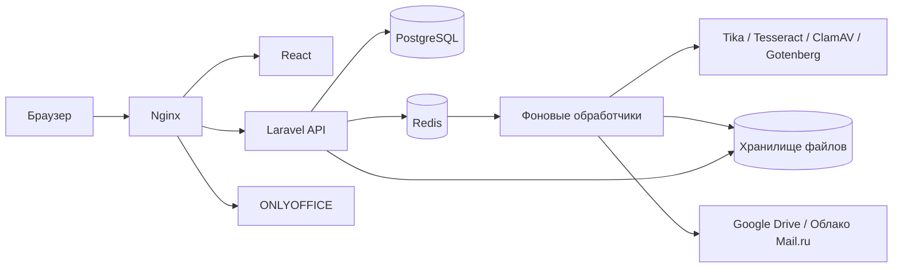

# Modern Tech

Командная библиотека документов. Загружайте файлы, ищите по содержимому, сравнивайте версии и обсуждайте отдельные фрагменты.


## Возможности

- Загрузка PDF, DOCX, XLSX, PPTX, TXT, Markdown, CSV, PNG и JPEG, проверка на вирусы, распознавание и индексация через очередь.
- Полнотекстовый поиск с ранжированием и фильтрами, версии, комментарии и журнал действий.
- Роли администратора, сотрудника и наблюдателя, права на отдельные документы.
- Форматированный Markdown, просмотр CSV и XLSX с переключением листов, постраничный просмотр PDF, DOCX и PPTX.
- Импорт и экспорт через Google Drive и Облако Mail.ru. [Настройка подключений](docs/integrations/cloud-oauth.md).
- Совместное редактирование DOCX в ONLYOFFICE: обычное сохранение обновляет рабочий файл, кнопка «Добавить новую версию» публикует изменения в истории.

## Архитектура

React 19 и TypeScript, React Router, TanStack Query, Zustand и Vite на клиенте. PHP 8.4 и Laravel 13 на сервере; PostgreSQL 18 для хранения и полнотекстового поиска, Redis для кэша и очередей. Apache Tika и Tesseract извлекают текст, ClamAV проверяет файлы, Gotenberg готовит постраничный предпросмотр. Сервисы запускаются через Docker Compose.



## Локальный запуск

Нужны Docker с Compose, Make, Python 3 и OpenSSL.

```sh
make up
```

Откройте [localhost:8088](http://localhost:8088). Зарегистрируйте сотрудника или создайте администратора:

```sh
docker compose exec api php artisan app:create-admin admin@example.test
```

Для ONLYOFFICE перед запуском создайте `.local/office.env` с `OFFICE_JWT_SECRET` (случайное значение: `openssl rand -hex 32`). Готовый DOCX с правом редактирования или комментирования открывается во вкладке «Совместная работа».

## Production

[Инструкция запуска и проверки](docs/production.md). Основная конфигурация — `compose.production.yaml`, изолированный проверочный стенд — `compose.staging.yaml`. Рабочие секреты, данные и резервные копии хранятся вне Git. Деплой выполняется отдельно после выбора площадки.

API описан в [OpenAPI](contracts/openapi.json). Интерактивная документация доступна в приложении по `/docs/api`; в production она защищена доступом администратора. [Серверная документация](backend/README.md).

## Проверки

Нужны Node.js 24 с npm, Docker и запущенный сервис `api`.

```sh
npm ci --prefix frontend
bash scripts/install-hooks.sh
bash scripts/check-quality.sh
```

`pre-commit` и `pre-push` запускают ESLint, Prettier, TypeScript, клиентские тесты и сборку, Pint, PHPStan, серверные и PostgreSQL-тесты. PostgreSQL-тесты используют отдельный временный контейнер без данных приложения. Перед коммитом добавьте все изменения в индекс; перед push рабочая папка должна быть чистой.

[GitHub Actions](.github/workflows/quality.yml) выполняет проверки на push и pull request, собирает Docker-образы и сохраняет отчёты о покрытии. `make coverage` обновляет локальные отчёты. Для PHP-покрытия нужны PHP 8.4+, Composer-зависимости, PDO SQLite и Xdebug. Сквозные проверки с отдельной базой описаны в [tools/app-e2e](tools/app-e2e/README.md).
