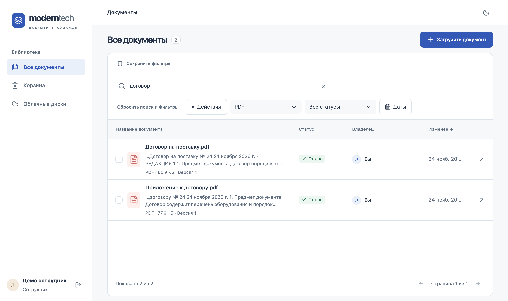

# Modern Tech

Командная библиотека документов. Загружайте файлы, ищите по содержимому, сравнивайте версии и обсуждайте отдельные фрагменты.



## Возможности

- Предпросмотр, распознавание текста на сканах и полнотекстовый поиск.
- Роли, права на отдельные документы и журнал действий.
- Импорт и экспорт через Яндекс Диск, Google Drive и Облако Mail. [Настройка OAuth](docs/integrations/cloud-oauth.md).
- Совместное редактирование DOCX в ONLYOFFICE с явной публикацией версии. Режим экспериментальный.

## Технологии

| Область | Что используется |
| --- | --- |
| Интерфейс | React 19, TypeScript, React Router и Tailwind CSS. TanStack Query обновляет данные API, Zustand хранит состояние интерфейса, Vite собирает приложение. |
| Сервер | PHP 8.4 и Laravel 13. Sanctum обслуживает сессии браузера, OpenAPI описывает HTTP API. |
| Данные и очереди | PostgreSQL 18 хранит данные и выполняет полнотекстовый поиск. Redis 7.4 обслуживает кэш и очереди фоновых задач. |
| Обработка файлов | ClamAV проверяет файлы, Apache Tika извлекает текст, Tesseract распознаёт сканы, Gotenberg конвертирует офисные файлы в PDF для предпросмотра. |
| Интеграции | ONLYOFFICE Docs для совместного редактирования. REST API и OAuth 2.0 для Google Drive и Яндекс Диска, WebDAV для Облака Mail. |
| Запуск и проверки | Nginx и Docker Compose для локального стенда. Vitest и PHPUnit для тестов, GitHub Actions для CI. |

## Локальный запуск

Нужны Docker с Compose, Make, Python 3 и OpenSSL.

```sh
make up
```

Откройте [localhost:8088](http://localhost:8088). Можно зарегистрировать сотрудника или создать администратора командой `docker compose exec api php artisan app:create-admin admin@example.test`.

Чтобы запустить ONLYOFFICE, перед `make up` создайте `.local/office.env` с `OFFICE_JWT_SECRET`. Секрет сгенерируйте командой `openssl rand -hex 32`. У готового DOCX с правом редактирования или комментирования появится вкладка «Совместная работа».

## Проверки

Для локальных хуков нужны запущенный контейнер `api` и Node.js 24 с npm.

```sh
npm ci --prefix frontend
./scripts/install-hooks.sh
```

- `pre-commit` проверяет пробельные ошибки, запускает ESLint и Prettier, проверяет типы и собирает фронтенд. При изменениях в `backend/` также запускает Pint и PHPStan.
- `pre-push` запускает `make test` — Vitest на клиенте и PHPUnit Unit и Feature на сервере.
- [GitHub Actions](.github/workflows/quality.yml) дополнительно запускает интеграционные тесты на отдельном PostgreSQL и публикует отчёты о покрытии.

## Покрытие тестами

Локальный замер покрытия строк от 26 ноября 2026 года.

| Код | Покрытие | Тесты |
| --- | ---: | ---: |
| Frontend (`frontend/src`) | 60,13% (860 из 1430) | 32 |
| Backend (`backend/app`) | 82,93% (2283 из 2753) | 140 |

`make coverage` обновляет отчёты. Для PHP-отчёта нужны локальные PHP 8.4+, зависимости Composer, PDO SQLite и Xdebug. HTML-отчёты открываются из `frontend/coverage/index.html` и `backend/coverage/index.html`. Сборка CI хранит их в артефактах `coverage-frontend` и `coverage-backend`.
