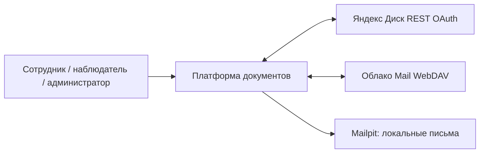
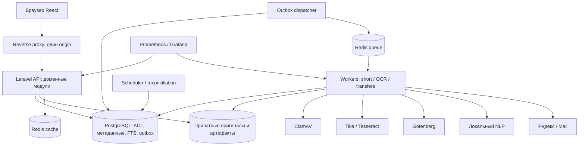
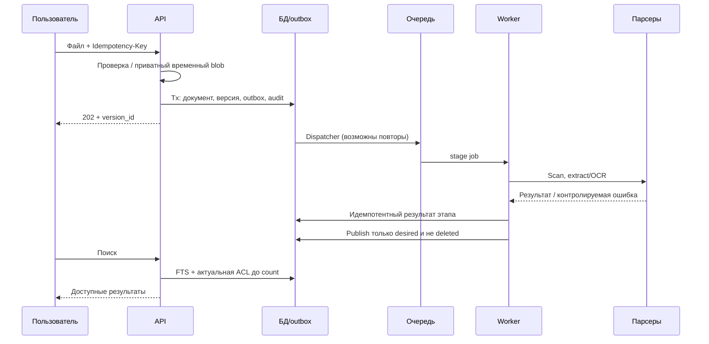
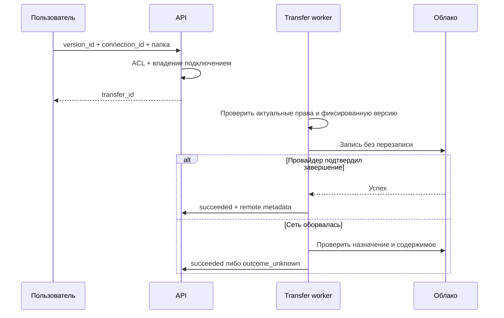
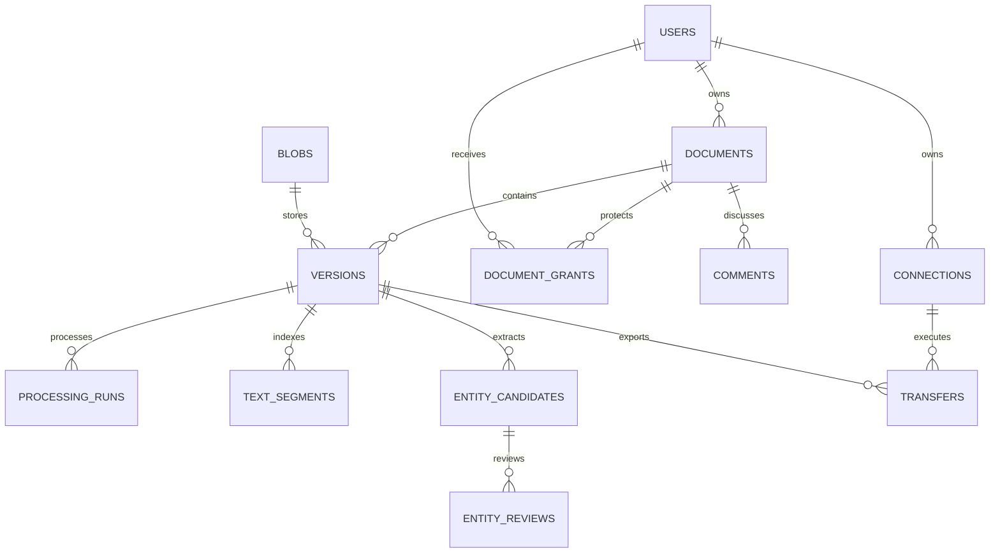

# Архитектура 1.0

Источник требований: SPECIFICATION.md. Статус: baseline для реализации, код ещё не создан.

## Контекст

## Контейнеры и границы

Клиент не обращается напрямую к БД, парсерам или credentials провайдера. Публичные порты обработчиков не открыты. Queue и cache используют разные экземпляры Redis. Все мутации ACL и связанный audit транзакционны.

## Загрузка и публикация

## Экспорт при неопределённом исходе

## Модель связей

Точный словарь полей, индексов и ограничений: раздел 20 ТЗ. desired/published принадлежат тому же документу; это дополнительно проверяется на уровне целостности/транзакции.

## Структура будущего репозитория

- frontend/src/{app,pages,features,shared}
- backend/app/Modules/{Identity,Access,Documents,Processing,Search,Entities,Collaboration,Audit,Integrations}
- services/nlp; infra/compose; contracts/openapi.yaml
- tests/fixtures; tests/e2e; docs; tools

Не создавать слои и абстракции только ради структуры: модуль владеет правилами, внешние вызовы находятся в адаптерах. Конкретные файлы приложения появятся при выполнении tasks.json.
