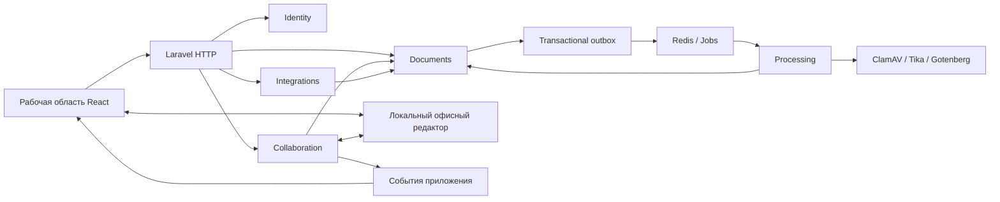

# План перепроектирования бэкенда Modern Tech

Дата: 7 ноября 2026 года. Статус: проектная схема и порядок реализации для итогового подтверждения. Решения Q1–Q20 отражены в ADR-002…005; технические имена и контракты ниже — предлагаемая реализация, код ещё не переписан.

Пользовательские истории, объём и критерии приёмки синтезированы в [спецификации](../.scratch/backend-refactoring-and-collaboration/spec.md). Этот документ дополняет её технической схемой; отсутствие доказанного прототипа не заменяется согласием с проектными именами.

## 1. Результат и границы

Сохраняется модульный Laravel-монолит. Допускается новая реализация схемы и API с нуля; ранее заявленные возможности приложения сохраняются. В объём добавлены открытая регистрация с подтверждением email, совместное редактирование DOCX/XLSX/PPTX, курсоры, живые комментарии и ограничение до 10 разных редакторов одного документа.

Согласованные правила:

- Одна инсталляция, новая учётная запись получает роль сотрудника. Чужие документы доступны по индивидуальному разрешению; новые документы приватны для остальных пользователей, административный доступ сохраняется.
- Подтверждение email требуется перед загрузкой, редактированием и комментированием.
- Рабочий черновик видят владелец и участники с edit/comment. Участник только с read видит опубликованную версию и доступный ей снимок обсуждений.
- Публикацию инициирует только владелец. Администратор чужого документа не получает это право автоматически.
- Публикация без подтверждённого сохранённого снимка не выполняется и показывает причину отказа. Смысловую готовность текста оценивает владелец.
- Первая загрузка владельцем является запросом выпуска первой версии; поиск начинает показывать её после успешной проверки и обработки.
- Последующие изменения автоматически сохраняются в черновике. Поиск использует последнюю опубликованную версию.
- При публикации фиксируется снимок обсуждений и привязок; дальнейшая работа не переписывает историю версии.
- Удалённый фрагмент оставляет ветку и цитату с пометкой утраченной привязки.
- Замена файла запрещена при активном редактировании или неопубликованных изменениях; сначала владелец публикует черновик либо явно отказывается от него.
- Несколько вкладок одного аккаунта занимают одно пользовательское место. Одиннадцатый участник получает доступный ему просмотр/комментирование, редактирование — после освобождения места и повторной попытки.
- Для обсуждений используется контекстная сворачиваемая панель с единым набором рабочих веток. Цвет автора постоянен внутри документа, имя видно всегда; цвет офисного курсора может отличаться.

Не добавляются автоматически multi-tenancy, публичные ссылки, отдельный процесс утверждения правок каждым участником, офлайн-редактор без связи с сервером, упоминания и дополнительные вложения к комментариям. Работа локального приложения без исходящего интернета после установки сохраняется и не означает поддержку редактирования при недоступном локальном сервере.

## 2. Модули и владение правилами

| Модуль | Владеет | Основные интерфейсы сценариев |
|---|---|---|
| Identity | Пользователями, ролями, подтверждением email, входом и блокировкой | RegisterUser, VerifyEmail, UpdateUser, DeactivateUser |
| Documents | Документами, файлами, версиями, черновиком, сохранёнными снимками, ACL, библиотекой | CreateDocument, ReplaceDocumentFile, PublishDocument, DiscardDocumentDraft, ReplaceDocumentGrants |
| Collaboration | Рабочими обсуждениями, привязками, их историческими снимками, редакторскими сессиями и местами участников | OpenDocumentSession, LeaveDocumentSession, CreateComment, UpdateComment, ResolveComment, CapturePublicationSnapshot |
| Processing | Выполнением проверок, извлечением текста и сущностей, индексированием и preview | ProcessDocumentVersion, ScanVersion, ExtractVersionText, IndexVersion |
| Integrations | Личными облачными подключениями и передачами | ConnectCloudAccount, RequestDocumentImport, RequestDocumentExport, CancelTransfer |

Аудит, outbox, технические логи и метрики находятся в общей инфраструктуре приложения. Отдельные бизнес-модули Access и Observability не сохраняются только ради группировки файлов.

Правила взаимодействия:

1. Модуль изменяет собственные данные; чужие сценарии вызываются через явный интерфейс, а не прямым обновлением чужой таблицы в контроллере.
2. Documents определяет право доступа и правила выпуска документа. Collaboration не вводит независимую копию ACL.
3. Для публикации Documents получает согласованный снимок через узкий контракт PublicationSnapshotProvider. Реализация в Collaboration собирает содержимое и обсуждения выбранного редактора; Documents не зависит от его HTTP-протокола.
4. Импорт и браузерная загрузка используют общий документный вход с явным источником файла. Внутренний сценарий не требует HTTP UploadedFile.
5. Processing сообщает результат через документный сценарий завершения обработки. Только актуальный ожидаемый выпуск может стать текущей опубликованной версией.
6. Изменение роли, блокировка и отзыв ACL уведомляют Collaboration через фиксируемые события; уже открытые сессии также теряют соответствующие возможности.
7. Общая инфраструктура не принимает бизнес-решения о праве публикации или принадлежности документа.

Стрелки показывают вызовы и сообщения. Обратный запрос снимка в Documents реализуется через контракт, определённый Documents; его реализация связывается при запуске приложения. Общий контейнер зависимостей не заменяет явные зависимости внутри сценариев.

## 3. Роль каждого типа класса

| Тип | Ответственность | Пример |
|---|---|---|
| FormRequest | Входные данные HTTP и их форма | PublishDocumentRequest |
| Controller | Преобразование HTTP-входа, вызов сценария, ответ | PublicationController |
| Policy | Кто и к какому ресурсу имеет право обратиться | DocumentPolicy, CommentPolicy, UserPolicy |
| Action | Завершённый сценарий, его бизнес-инварианты и транзакционные изменения | PublishDocument, ReplaceDocumentGrants |
| Query | Выборка, фильтрация, ранжирование и пагинация | DocumentLibraryQuery, PublishedDocumentSearchQuery |
| Adapter | Протокол внешнего продукта за понятным контрактом | OnlyOfficeEditor, YandexDiskClient, TikaTextExtractor |
| Job / Command | Доставка фоновой работы или консольный вход в сценарий | ProcessVersionJob, DispatchOutboxCommand |
| Resource / Result | Контролируемый результат для потребителя | DocumentResource, PublicationResult |

Actions располагаются в `app/Modules/<Module>/Actions/`, имеют один публичный типизированный `handle()`, зависимости через конструктор и явные аргументы. Они не читают Request, cookie или глобальный текущий запрос. DTO вводятся, когда действительно нужны согласованный состав входа или межмодульный контракт; универсальные базовые Action/Service/Repository не вводятся заранее.

Policy проверяется на всех входах сценария, включая фоновые операции от имени пользователя. Инварианты, зависящие от текущего состояния, дополнительно проверяются внутри транзакции после блокировки необходимых записей. Проверка последнего администратора, лимита мест или актуальности снимка не переносится целиком в Policy.

SQL-ограничение видимости применяется до count, FTS-ранжирования и пагинации. Проверять Policy после получения страницы недостаточно. В DocumentPolicy не должно быть безусловного административного разрешения, обходящего owner-only publish.

### Что меняется относительно существующих классов

| Сейчас | Предлагаемая роль |
|---|---|
| Access/Services/DocumentAccess | DocumentPolicy и SQL-ограничение видимости в документных Query |
| Documents/Services/UploadDocument | Отдельные CreateDocument и ReplaceDocumentFile с общим входным контрактом файла |
| Documents/Services/DocumentListing | DocumentLibraryQuery |
| Documents/Services/SearchDocuments | PublishedDocumentSearchQuery или его составная часть |
| Мутации в DocumentController | RenameDocument, TrashDocument, RestoreDocument, PublishDocument, ReplaceDocumentGrants |
| Мутации в CommentController | CreateComment, UpdateComment, DeleteComment, ResolveComment и CommentPolicy |
| Статический Audit::record | Явный AuditWriter в общей инфраструктуре |
| TikaExtractor, ClamAvScanner, облачные провайдеры | Адаптеры с названиями по роли; не превращаются автоматически в Actions |
| Реализация outbox/reconciliation в routes/console.php | Отдельные Command и сценарии восстановления с проверяемыми границами |

## 4. Предлагаемая модель данных

Это логические сущности; окончательные таблицы, индексы и поля фиксируются после технического прототипа.

| Область | Сущности и назначение |
|---|---|
| Identity | User с ролью, состоянием активности и подтверждением email |
| Documents | Document, DocumentGrant, DocumentVersion, DocumentDraft, ConfirmedSnapshot; Folder, Tag, Favorite сохраняют назначение |
| Collaboration | EditingSession, EditorSeat, CommentThread, Comment, DiscussionAnchor, VersionDiscussionSnapshot, DocumentAuthorColor |
| Processing | Состояние этапа и попытки, TextSegment, DocumentEntity, PreviewArtifact |
| Integrations | CloudConnection, CloudTransfer |
| Общая инфраструктура | AuditEvent, OutboxEvent, запись идемпотентности |

Ключевые связи и инварианты:

- У документа не более одного текущего рабочего черновика и одного указателя на опубликованную версию. Черновик имеет поколение и основание — версию, из которой начата работа.
- Сохранённый снимок содержит неизменяемую ссылку на файл, контрольную сумму, подтверждение редактора и согласованный снимок обсуждений. Указание только document_id недостаточно для позднего callback.
- Опубликованная версия фиксирует содержимое и состояние обсуждений. Автосохранённый checkpoint не становится версией истории автоматически.
- Рабочая ветка имеет устойчивую идентичность, автора и область документа; исторический снимок хранит её состояние на момент выпуска и не участвует в двустороннем редактировании.
- Привязка Office-комментария описывает структурный контекст редактора. Координаты извлечённого plain text не используются как универсальный якорь DOCX/XLSX/PPTX.
- Цвет комментария связан с парой документ–пользователь, а не с вкладкой или текущим подключением. Авторство всегда показано текстом.
- Место редактора учитывает человека. Вкладки и соединения учитываются отдельно; закрытие одной вкладки не освобождает место при другой активной вкладке того же человека.
- Допуск десятого/одиннадцатого редактора атомарен; read-then-count без защиты от гонки не подходит. Восстановление после разрыва и освобождение просроченных мест проверяются отдельно.
- История обсуждений опубликованной версии не получает события текущего черновика. Прежний read-only участник не должен получить новый черновик через WebSocket, счётчики или preview.

Следствие общей модели для итогового подтверждения: живые обсуждения относятся к рабочему контексту; читатели опубликованной версии получают сохранённый снимок. Для PDF/изображений меняется обсуждение, а не содержимое файла; при выпуске только обновлённого обсуждения можно сохранить прежний неизменяемый файл и переиспользовать подтверждённые артефакты. Это нужно явно показать в интерфейсе, чтобы пользователь не путал версию содержимого и новый снимок обсуждений.

## 5. Публикация и внешние callback

Предлагаемая последовательность:

1. Владелец запрашивает публикацию; проверяются активность, подтверждение email и владение документом.
2. Адаптер редактора формирует подтверждённый снимок содержимого и обсуждений одного рабочего поколения. При неподтверждённом сохранении, конфликте поколения или недоступности редактора выпуск не создаётся.
3. После сохранения артефакта короткая транзакция блокирует документ и повторно проверяет владельца, состояние, поколение и идемпотентность. Создаются кандидат версии, снимок истории, audit и outbox.
4. Очередь выполняет проверку файла, извлечение, индексацию и необходимые производные операции. До готовности поиск продолжает использовать предыдущую опубликованную версию.
5. Только актуальный ожидаемый выпуск становится опубликованным. Ошибка оставляет прежнюю версию доступной и показывает причину.
6. Более поздние изменения черновика не должны ошибочно помечаться опубликованными или сохранёнными этим снимком.

HTTP-запросы к редактору не выполняются внутри долгой SQL-транзакции. Прототип должен подтвердить согласованную границу файла и комментариев; нельзя выдать их раздельное сохранение в произвольные моменты за единый снимок.

Callback редактора аутентифицируется, связан с конкретными сессией, поколением и запросом снимка, допускает повторы и запоздалую доставку. Автосохранение или закрытие окна само по себе не инициирует публикацию. URL получения файла ограничен доверенным редактором, сроком действия и размером; произвольный URL из входного тела не скачивается.

## 6. Realtime и права

Офисный редактор синхронизирует содержимое и свои курсоры. Laravel управляет учётными записями, ACL, допуском участников, публикацией и событиями приложения. Передача нажатий клавиш через очередь фоновой обработки не предлагается.

Для событий приложения предлагается локальный Laravel Reverb/Echo; совместимость с текущими версиями и выбранным редактором проверяется до установки зависимостей. Рабочие обсуждения и опубликованная история используют разные авторизуемые области подписки.

События постоянных изменений доставляются после фиксации данных с идентификатором и порядком, достаточными для повторного получения состояния. После разрыва клиент сверяет состояние; сообщение WebSocket не является единственной копией комментария. Высокочастотное присутствие и движение курсора не записываются в аудит как каждое пользовательское действие.

Предлагаемые эксплуатационные правила для итогового подтверждения:

- Отзыв edit прекращает дальнейшее редактирование; при сохранённом доступе к черновику остаётся соответствующий режим просмотра/комментирования.
- Потеря последнего права edit/comment при сохранённом read прекращает доступ к черновику во всех вкладках, старым токенам редактора и его событиям. Пользователь переводится к опубликованной версии. Если одно из этих прав сохранилось, доступный режим черновика пересчитывается.
- Отзыв read или блокировка прекращают дальнейшую выдачу содержимого и событий и закрывают редакторскую сессию. Одного скрытия кнопок на клиенте недостаточно.
- Уже подтверждённые изменения сохраняются. Гарантия восстановления неподтверждённого ввода в отключённом браузере не обещается.
- Самостоятельный офлайн-режим с последующим слиянием конфликтующих файлов не входит в первый этап; потеря связи имеет ясный статус и сценарий восстановления.
- Неактивный владелец не заменяется администратором при публикации. Передача владения — отдельная функция, которая пока не согласована.
- Административное скрытие исторического комментария, предусмотренное прежними требованиями, ограничивает его выдачу и фиксируется в аудите; сохранённый снимок не переписывается. Рабочие комментарии и их исторические снимки не разделяют один изменяемый текст.

## 7. Технический прототип до переписывания

Первый кандидат — локальный ONLYOFFICE Docs Community с нативным ARM64-образом. Это кандидат для проверки, не окончательно утверждённый движок. Вариант Collabora CODE сохраняется как альтернатива; переход к нему или платному API не выполняется молча.

Прототип размещается отдельно от рабочих данных и не требует сброса текущей БД. Проверки выполняются на синтетических DOCX/XLSX/PPTX.

| Проверка | Условие успешного результата |
|---|---|
| Совместное содержимое | Два независимых пользователя видят изменения и курсоры в одном документе |
| Файлы | Редактор возвращает файл; повторное открытие сохраняет проверяемые текст, формулы, структуру и оформление тестового корпуса |
| Комментарии | Бесплатный путь создания/ответа/закрытия и событий работает во всех трёх форматах с одной рабочей моделью веток |
| Панель и цвета | Сворачиваемая панель показывает выбранную ветку, постоянный цвет и имя; нет независимо изменяемой дублирующей истории |
| Привязки | Вставка/удаление текста, строк и слайдов не переносит комментарий на неверный фрагмент |
| Публикация | Файл и обсуждения относятся к одному подтверждённому снимку; нет ложного успешного выпуска при ошибке сохранения |
| Права | Read-only опубликованная версия, comment-only черновик, отзыв прав и блокировка проверены при уже открытом редакторе |
| Лимит | 10 разных редакторов допускаются; одиннадцатый не получает edit, две вкладки одного аккаунта не расходуют второе пользовательское место |
| Ресурсы | Измерены CPU/RAM, время открытия/сохранения и несколько одновременно открытых документов на целевом локальном стенде |

По результатам фиксируются тег/версия редактора, контракты, измеренный общий бюджет приложения и ADR о выборе движка. Если бесплатная интеграция комментариев или согласованный снимок не подтверждены, сначала обсуждаются варианты, затем меняется план. Непройденный критерий не объявляется выполненным по наличию документации.

Первичные источники для кандидатов и протоколов:

- [ONLYOFFICE: совместное редактирование](https://api.onlyoffice.com/docs/docs-api/get-started/how-it-works/co-editing/).
- [ONLYOFFICE: callback handler](https://api.onlyoffice.com/docs/docs-api/usage-api/callback-handler/).
- [ONLYOFFICE: Docker ARM64 и системные требования](https://helpcenter.onlyoffice.com/docs/installation/community/docker/sys-reqs).
- [ONLYOFFICE: ограничения Automation API](https://api.onlyoffice.com/docs/docs-api/usage-api/automation-api/).
- [ONLYOFFICE: plugin API комментариев](https://api.onlyoffice.com/docs/plugins/interacting-with-editors/document-api/Methods/GetAllComments/).
- [Laravel: broadcasting](https://laravel.com/framework/docs/broadcasting).

## 8. Этапы реализации и проверки

| Этап | Результат | Приёмка |
|---|---|---|
| 0. Прототип | Доказанные возможности редактора, сохранения, комментариев, прав и ресурсного бюджета | Матрица выше с фактическими pass/fail, закреплённая версия и решение о движке |
| 1. Основа модулей | Структура, договорённости Actions/Policies/Query/Adapters, общие Audit/Outbox, проект схемы | Проверяемые зависимости модулей, миграции в изолированном окружении, сохранённый исходный код и документы |
| 2. Identity | Открытая регистрация, подтверждение email, вход/выход, роли и блокировка | API-негативы, rate limit, недоступность мутаций до подтверждения, защита последнего администратора |
| 3. Documents | Файлы, ACL, библиотека, версии, черновики и запросы публикации | SQL-видимость до пагинации, owner-only publish, первая загрузка, конфликт состояния, запрет замены активного черновика |
| 4. Processing | Очереди, антивирус, текст/OCR, сущности, FTS, preview и восстановление | Реальные PostgreSQL/Redis, повторы, перезапуск worker, ошибка обработки без потери прежней опубликованной версии |
| 5. Collaboration | Редактор, места участников, realtime, якоря, рабочие обсуждения и снимки | Два браузера, 10/11 участников, несколько вкладок, ревокация, разрыв связи, согласованная история |
| 6. Integrations | Существующие облачные сценарии на новых документных Actions | Контрактные негативы и отдельно реальные round-trip при наличии учётных данных |
| 7. Рабочий интерфейс | Согласованная контекстная панель и ясные статусы, подключение нового API | Длинные документы/названия, обе темы, клавиатура, собственная отправка и входящие события без потери позиции |
| 8. Поставка | Полный контракт, документация, CI/CD, Docker Compose и воспроизводимый демонстрационный запуск | Линтеры, тесты, сборка образов, deploy/smoke/restore; реальный PR-review подтверждается отдельно |

Тесты бэкенда включают unit, API и интеграционные сценарии на реальных PostgreSQL/Redis. SQLite не является доказательством поведения FTS и конкурентного допуска редакторов. Тесты интерфейса проверяют поведение, а браузерные сценарии — реальную геометрию и работу нескольких клиентов.

ТЗ в Markdown и PDF синхронизируется после подтверждения модели и прототипа; обязательный PDF сохраняет объём 25–30 страниц. В нём не остаются прежние исключения публичной регистрации и realtime. CI собирает проверенные образы; локальный staging/deploy подтверждается журналом и smoke. Наличие workflow или инструкции не выдаётся за успешный запуск или человеческое ревью.

Общий предел приложения пока не задаётся произвольным числом: его определяют измерения прототипа и выбранный ресурсный профиль. До такого подтверждения не обещается неограниченная нагрузка.

## 9. Статус согласования

Продуктовые решения Q1–Q20 записаны. Этот документ делает предлагаемую реализацию и её следствия проверяемыми до начала переписывания. Итоговое подтверждение должно охватить схему модулей, модель обсуждений и публикации, эксплуатационные правила из раздела 6 и порядок «сначала прототип, затем реализация».

Связанные документы: [словарь](../GLOSSARY.md), [ADR-002](adr/0002-backend-redesign.md), [ADR-003](adr/0003-business-modules.md), [ADR-004](adr/0004-drafts-and-publication.md), [ADR-005](adr/0005-discussions-and-version-history.md), [исследование дизайна](DESIGN_RESEARCH.md).
